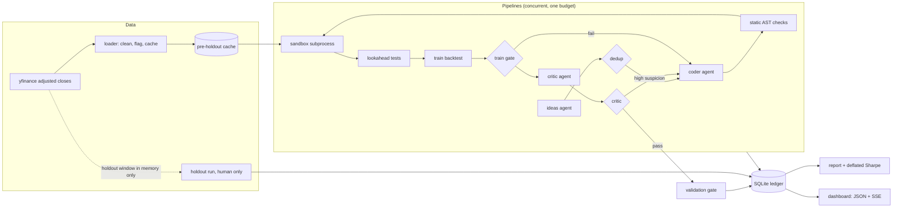

# Alpha Lab

[](https://github.com/RafaelPF07/alpha-lab/actions/workflows/ci.yml)

A research harness for daily equity trading signals. The goal is not to find alpha. The goal is an honest, well-tested pipeline that resists lookahead bias, overfitting and data snooping, plus evidence that it does.

## What it is, and what it deliberately is not

- **Is:** a deterministic backtester, lookahead tests, a sandboxed LLM agent swarm that writes `signal(prices) -> weights` functions, a critic, a validation gate, deflated Sharpe ratios, a one-time holdout, and a local dashboard.
- **Is not:** a trading system. There is no order placement anywhere. Paper trading is a documented stub (`src/alpha_lab/pipeline/paper.py`).
- **Is not a security boundary.** Signal code runs as your Windows user with no operating-system isolation. Every guard in the sandbox is an in-process convenience layer, not isolation. Read [Sandbox: what it does and does not stop](#sandbox-what-it-does-and-does-not-stop) before you rely on any guard.

## Architecture



## Setup

Requires Python 3.11+ and [uv](https://docs.astral.sh/uv/).

```bash
uv sync
uv run pytest
```

- Only editable installs (`uv sync`) are supported. `config/` and `prompts/` are read from the repository root, and a wheel built from `src/` contains neither.
- Put your Anthropic key in `.env` (copy `.env.example`). `.env` is gitignored. Never commit a real key. The file must be UTF-8, and a key set twice is an error: `lab run` then exits with code 2 and sets nothing. Signal code runs as your Windows user, and the in-process guards do not protect `.env`: the child is the same user, and it can read that file through routes the guards do not name (see the Sandbox section).
- The price cache carries a fingerprint of its tickers, dates and cleaning settings. The fingerprint's digest and its full body must both match the current settings. A cache without a fingerprint, or one built under other settings, is refused (`CacheMismatch`) until you run `uv run lab data fetch --refresh`. The fetch stops at `validation_end`. The fingerprint also records the cleaning rule version (`CLEANING_RULE` in `data/loader.py`, currently 2), so a cache built under the older universe rule is refused even when its digest is copied. The fingerprint is a consistency check: anyone who can write `data/` can write a matching one.
- Which tickers are kept is decided with the training window only, from start to `train_end` (DECISION-15). Caches and validation numbers built before that rule was in place are stale. Refresh the cache, and re-run validation before any holdout.
- The tests are offline by design. `tests/conftest.py` makes accidental network use fail inside the test process (see Tests and CI), and the model is replaced by scripted fakes (`tests/fakes.py`).

## Running each phase

```bash
uv run lab data fetch                       # Phase 0: download and cache prices
uv run lab data fetch --refresh             # re-download; needed after a cleaning-rule change or when the cache has no fingerprint
uv run lab data summary                     # data-quality report, incl. daily moves beyond +/-15%
uv run lab ledger migrate                   # once after an upgrade, if a read command says the ledger is older
uv run lab backtest momentum_12_1 --split train
uv run lab run --pipelines 20 --budget 2.00 # Phases 1-2: the agent swarm, live progress
uv run lab ledger show --run <RUN_ID> --code
uv run lab report --run <RUN_ID>            # Phase 3: Markdown + HTML + figures in runs/<RUN_ID>/
uv run lab holdout --run <RUN_ID> --top 5 --i-understand-this-is-final   # Phase 4: human only
uv run lab dashboard --demo                 # Phase 5: no API calls, synthetic run
uv run lab dashboard --run <RUN_ID>         # Phase 5: a real run
```

- `lab holdout` needs an interactive console and a typed confirmation code. It refuses piped or scripted input, and it refuses the Windows null device.
- `lab holdout --top` ranks only the signals that passed validation, by deflated Sharpe ratio, and it refuses when the deflated Sharpe is not defined for that run (see the DSR section). `--attempt` (repeatable) selects specific validated attempts instead and is not affected by that refusal.
- `lab dashboard --run <id>` checks read-only that the run exists, and exits 1 with `no run with id` when it does not. `--demo` skips the check.
- `lab run` prints "passed critic" and "passed validation" as two separate counts. There is no single "passes" count.
- `lab run` has no seed option. The theme for each pipeline is drawn with `run.seed` (42 in `config/settings.toml`), so two runs with the same `--pipelines` get the same theme sequence.

## How a run ends

Run statuses (`runs.status`, defined in `src/alpha_lab/statuses.py`):

| Status | Meaning |
|---|---|
| `running` | Written when the run starts. It stays so until the run finishes or is abandoned. |
| `completed` | The run finished and none of the other rules below applied. Some pipelines may still have ended in `failed_error`, `failed_api` or `failed_backtest`. The number that ended in `failed_backtest` is written to `run_finished` as `data_failed_pipelines`. |
| `budget_stopped` | Fewer pipelines produced a result than were started, because the budget ran out. Budget exhaustion ends the whole run. |
| `failed` | An exception that nothing else handles ended the run, or every pipeline ended in `failed_error` or `failed_api`. |
| `failed_data` | Every pipeline ended in `failed_backtest`, so no window could be scored. |
| `interrupted` | The run was stopped by Ctrl+C or cancellation. |
| `abandoned` | Closed by the next `lab run` (see below). |

- **Unexpected errors (DECISION-5).** An unexpected error in one pipeline ends that pipeline with a terminal status (`failed_error`, or `aborted_error` when it was open when a run was closed). The run continues. Only budget exhaustion and authentication errors end the whole run.
- **Authentication (DECISION-10).** HTTP 401 and 403 are run-fatal. They are never retried, even when the server's `x-should-retry` header says so, because the key cannot make a later call succeed.
- **Retries.** A call is attempted at most four times. Timeouts, connection errors, 408, 409, 429 and 5xx responses are retried, and so is any other response whose `x-should-retry` header is `true`. A header of `false` stops the retry. 401 and 403 are never retried (DECISION-10). A server `retry-after` is honoured up to 60 seconds. Each retry writes an `llm_call_retrying` event before it waits, so a retrying run keeps writing events. The client uses the SDK's default timeout of 600 seconds per request. The stale bound below depends on that timeout, so it must not be changed without changing the bound.
- **Budget.** Before each call, the worst-case estimate (its reservation) is checked against what is left. A call that does not fit is refused with `BudgetExceeded` before anything is sent. The billed usage can be larger than the reservation, so a call can overshoot the limit. When spend passes the limit, the run writes `budget_overrun`, and every later call is refused. A call that ends in an error is charged its reservation. A call cancelled while it waits to retry is charged nothing (`cancelled_before_send`). The demo does not overrun its budget, so the overrun event is not shown there.
- **Cost.** A run's total cost is the sum of its `llm_calls` rows (DECISION-5). The budget counts every call. If a ledger write for a call fails, that call still counts against the budget, but its row is missing, so the run's total leaves its cost out and is lower than the spend the budget tracked. The failed write is printed to stderr, and that call's `llm_call_finished` event has `recorded=false`. Nothing repairs the sum afterwards. Whether to retry or buffer failed writes is an open owner decision (R3-AGT-04).
- **Prompt caching.** The system prompt is sent with an ephemeral cache marker, so a call can write the cache. Each agent model needs a `cache_write_5m` price, and a model with a long-context tier needs `cache_read_over_100k`. `lab run` refuses to start, before its run row is written, while any agent model lacks a required price. The shipped `config/settings.toml` lacks both, so **`lab run` cannot start until the owner adds them** from the pricing page. This repository does not guess prices.
- **Stale bound.** The longest silence of a live run is about 11 minutes: one request can take up to the 600 s timeout, a retry waits at most 60 s when the server sends `retry-after` (otherwise 1, 2 or 4 s), and each retry writes `llm_call_retrying` before it waits. The 30-minute bound (`STALE_RUN_AFTER` in `pipeline/run.py`) is therefore longer than any silence a live run can have.
- **Abandoned runs.** A run with no event for 30 minutes is marked `abandoned` when the next `lab run` starts. Its attempts still marked `running` become `abandoned`. Each pipeline it left open gets `pipeline_finished` with `aborted_error`, and the run gets `run_finished`. Its total cost is the sum of its `llm_calls` rows. Until the next `lab run` starts, a run that died stays `running` in the ledger. Once the newest event is more than 30 minutes old, the dashboard API reports that run as status `abandoned`, with `stored_status: running`. This applies to `/api/runs`, to the run summary and to the stream's closing frame. The ledger keeps `running` until the next `lab run` writes `abandoned`. The API's `stale` flag is not set for runs. It is set only for a holdout that is still `running` after six hours (see the Dashboard section).

## Anti-overfitting design

- **Agents write only `signal(prices)`.** Each piece of generated code first goes through a static AST filter, which rejects a denylist of names, attributes and imports. The filter is a first layer, not a complete check. The code then runs in a sandbox child process with runtime guards. The Sandbox section says what this does and does not stop.
- **Lookahead tests.** Every signal must pass a truncation test and a perturbation test on training-period prices, at five cut-off dates spread between 15% and 95% of the training rows. `cheater`, a deliberately broken signal that reads tomorrow's return, must fail both, and it does (`tests/test_lookahead.py`). Rows after the last cut-off (the final 5% of the training rows) are not compared, so a leak confined there is not detected. A separate test checks that net returns up to a cut-off do not change when later prices change (`tests/test_engine.py`).
- **Timing (same bar).** A weight decided from the close of day t earns the return from close t to close t+1 (`weights.shift(1) * returns`). The decision and the fill share a bar, and no extra delay is modelled. That is optimistic for a signal that could not trade at the close that produced it, and the results are sensitive to this lag (see Known limitations).
- **Windows.** Train, validation and holdout windows do not overlap. A return counts toward the window of the day it is realised on. A backtest window may end up to 7 calendar days after the last price, or start up to 7 days before the first (`WINDOW_TOLERANCE_DAYS` in `backtest/engine.py`). A larger overflow raises `BacktestDataError`. A gap of more than four weekdays between consecutive price rows is refused (`MAX_INTERIOR_GAP_WEEKDAYS`) when the later row lies inside the window being scored. A gap entirely before a window is not checked, because it cannot change a return that the window scores. A gap of up to four weekdays is accepted, and a single missing weekday or holiday is still spanned by one return, because there is no trading calendar. A `BacktestDataError` in the training stage ends the attempt as `failed_backtest`, and so does one in the validation stage.
- **Information hiding.** Agents receive prices only up to `train_end`. Validation runs once, after the revision loop has finished, so the revision loop never sees a validation result, and validation prices are cut at `validation_end`. `tests/test_validation.py::test_validation_metrics_never_reach_any_agent` checks that five renderings of one run's validation metrics do not appear in any request sent to a model: the Sharpe ratio as `repr` and to three decimals, and the annual return, maximum drawdown and average daily turnover as `repr`. A rounded or reformatted number is not caught.
- **Universe (DECISION-15).** A ticker is dropped when more than the allowed fraction of its training-window rows are missing, or when it has a training-window gap that forward fill cannot close. Only rows up to `train_end` decide this, so validation and holdout prices cannot change which tickers are kept. A ticker whose gap lies only in validation or holdout is kept. A backtest over that window then fails with `BacktestDataError` only when the NaN falls on a day the ticker is held or traded, and the attempt ends `failed_backtest`. That gap is open (see Known limitations).
- **Holdout locking.** The holdout is for the owner only.
  - Only `lab holdout` downloads the holdout window. It is held in memory and is never written to disk by the loader. The price cache stops at `validation_end`. The SHA-256 of the holdout window is recorded in the ledger with the run.
  - One holdout per idea (DECISION-3). The rule is keyed on `idea_id`, so a second attempt on the same idea is refused, including a renamed or re-parameterised one. A new idea with near-identical code is still eligible. That gap is open and needs an owner decision (R3-SEC-04).
  - Duplicate check for older ledgers. A ledger that predates the rule may hold two holdout rows for one idea. Opening it then prints the affected ideas to stderr. A non-unique index (`holdout_runs_by_idea`) is created in place of the unique one. The rule is still enforced in code, inside the claim transaction. `Ledger.holdout_duplicates()` lists the duplicates. To inspect them, run `SELECT h.*, a.idea_id FROM holdout_runs h JOIN attempts a ON a.attempt_id = h.attempt_id WHERE a.idea_id IN (...)` with the ideas from stderr. The current ledger has no `holdout_runs` rows, so there are no duplicates in it.
  - `lab holdout` needs an interactive console and a typed code. It refuses piped or scripted input and the Windows null device, by checking that stdin is a console. That check proves nothing about a human: a program that controls a pseudo-terminal can still answer the prompt. The holdout invocation no longer records a console flag (R4-SEC-07). No in-process check stops that.
  - Static check before any claim. `lab holdout` runs the current static filter on every eligible candidate's code first. If any candidate is refused, the whole holdout run is refused, names the candidates, and claims nothing. A candidate validated under an older filter can otherwise carry a read that the current filter now refuses (R4-SEC-02).
  - Claim before read. Every eligible candidate gets a `running` row in one transaction before the holdout window is downloaded. If the run fails or is interrupted, those rows become `error`, and the idea stays used (DECISION-14). This ordering is an owner decision (R4-STAT-04), and it is kept. The trigger that uses it: a NaN gap longer than the forward-fill limit in a held ticker, inside the holdout window, makes that candidate's holdout fail with `BacktestDataError`. The row is marked `error`, and the claim is kept. A holdout-window NaN on a day the ticker is not held scores as no return. A `BacktestDataError` during the holdout run also leaves the idea used. Whether a data error should refund the holdout is an open owner decision.
  - The candidate's code runs on the holdout window in the child process, so the code can read those prices. Whether it can also write them to disk is covered in the Sandbox section.
  - The holdout is protected by convention and by runtime checks, not by a boundary.
- **Validation numbers are visible to the owner.** Validation metrics appear on research pages and in the signal inspector (DECISION-1). They are never sent to a model.
- **Trial counting.** N is every attempt that reached the sandbox, including attempts that later failed. The trials table is append-only: triggers refuse `DELETE`, `UPDATE`, and an `INSERT` that would replace an existing trial. V is the variance of the train Sharpe ratios of the trials that have a finite one. Attempts that fail early count in N but not in V, so the correction is not guaranteed conservative. The report states both counts.
- **Deflated Sharpe ratio.** Bailey and Lopez de Prado (2014), with N and V as above. The trial variance is measured on train-length samples, so it is rescaled to each candidate's validation length before it sets the hurdle: V_adj = V_train x (T_train - 1) / (T_val - 1), where T_train is the median number of train days behind the trials (DECISION-6, `length_matched_variance` in `ledger/report.py`).
  - The DSR fails closed (DECISION-12). It is NaN, and the report says why, in three cases: fewer than two trials have a finite train Sharpe; the trial Sharpe ratios have no spread, meaning their variance is zero or below rounding (under 1e-6 of the sampling variance 1/(T-1), R4-STAT-01); or the ledger holds no train lengths for the trials (R4-STAT-07). In the last case no validation DSR is computed, and no fallback to the unmatched variance is used. It is never replaced by the uncorrected value.
  - The SR0 and DSR expressions were checked against secondary sources only. The paper could not be retrieved while this code was reviewed, so its own expressions are not verified here.
  - The tests check a closed-form DSR value (`tests/test_deflated_sharpe.py`), a 500-series pure-noise Monte Carlo where the best noise series must not be called significant after deflation, and a length-matched noise simulation whose median DSR must lie between 0.35 and 0.65 (`tests/test_report.py`).
- **Critic.** A separate model reviews every signal that passes the training gate, looking for hidden lookahead, overfitted constants, market-tracking and fragility. A `high` suspicion rating sends the signal back to the coder. `low` and `medium` pass.

## Known limitations

- **Survivorship bias.** The universe is today's large caps and sector ETFs. Companies that failed or left the index are absent, so results are optimistic.
- **Universe and validation gaps.** The universe is decided on training rows (DECISION-15). A ticker with a gap that only validation or holdout prices show is kept. A backtest over that window fails only when the NaN falls on a day the ticker is held or traded. A NaN return on a column with zero position on that day and the day before scores as no return. A NaN on a held or traded column fails the window.
- **Data quality.** yfinance is a free source. Spinoffs, splits and dividend adjustments can be wrong. Daily moves beyond +/-15% are flagged in `lab data summary`, and moves beyond +/-50% are marked extreme. Prices are adjusted closes, restated backwards from the latest date, so a past adjusted level depends on corporate actions that came later. Ratio features over a window see only actions inside that window. Level-based features can see later actions, and the coder prompt does not yet ban them (owner decision).
- **Dashboard and ledger writes.** The read commands (`lab ledger show`, `lab report`) and `lab dashboard` open the ledger read-only. They never create or migrate it. A missing ledger is not created: `ledger show` and `report` print "No ledger at ..." and exit 1, and the dashboard answers 503. A ledger written by an older version is refused by all three, with a message to run `lab ledger migrate` once. `lab ledger migrate` is the explicit write, and it creates the file if it is missing. Only the commands that record something (`lab run`, `lab holdout`, `lab ledger migrate`) open the writable connection, which runs the migrations. A failed event write is printed to stderr and dropped from the ledger, but the live stream still delivers the event, so the live page and a later replay can differ.
- **Report figures load plotly.js from a CDN without an integrity hash.** `lab report` writes each figure with `include_plotlyjs="cdn"` (`ledger/report.py`). Adding an integrity check needs the owner's permission to download the library (R4-WHOLE-12).
- **Turnover and drift.** Turnover is measured from changes in target weights. Between rebalances the engine holds target weights constant. Returns therefore assume a constant mix, not buy-and-hold, and the equal-weight benchmark is constant-mix too. Constant-weight signals pay turnover only at entry, and nothing afterwards.
- **Same-bar execution.** Signals decided at close t earn the return from close t to close t+1, as described above. Every run also records the validation Sharpe with fills one bar later (`sharpe_lag1`). The report's "Execution lag" section shows lag 0 and lag 1 side by side for the top signals. Runs recorded before this change have no lag-1 figure and show n/a. The results are sensitive to this lag, and the lag-1 table is the check for it. `run_backtest` takes an `execution_lag` argument, which defaults to 0.
- **No borrowing costs for shorts, and no slippage beyond fixed basis points.** Costs are 5 basis points per side (`config/settings.toml`).
- **Small universe** of 50 names (9 ETFs and 41 stocks).
- **Possible LLM lookahead.** Language models may have learned about the post-2010 market during training. This is a subtle form of lookahead, and the harness cannot remove it.
- **Sandbox is not a boundary.** The signal runs as your Windows user, can read any file that user can read (including `.env`, through routes the in-process guards do not cover), and has no network isolation. See the Sandbox section.
- **Lookahead tests cover the signal function only**, on training-period prices, and not the final 5% of training rows (see the anti-overfitting section). Validation and holdout runs call the same code on later data, and no lookahead test checks that path.
- **The deflated Sharpe ratio.** The expected maximum is a Gumbel approximation, not an exact formula. Against a seeded Monte Carlo with 100,000 draws and unit trial variance, the formula is 0.045 low at N = 2, and 0.035, 0.022 and 0.018 high at N = 10, 100 and 500 (the docstring in `backtest/metrics.py`). `test_expected_max_is_within_the_documented_band_of_monte_carlo` checks each of those N within 0.05. The variance rescaling assumes that the spread across trials is mostly sampling noise. That is not verified on real trials.
- **Context-size guard.** The context guard estimates tokens as characters divided by a fixed 3.5. That ratio is not measured against the tokenizer, so the "stay under 100K" target is an estimate.
- **Idea deduplication.** The ideas prompt shows up to 30 earlier ideas (`AVOID_LIST_SIZE` in `agents/ideas.py`): up to 15 from the same theme first, then the newest. The duplicate check compares against every idea, so an old idea the prompt does not show can still block a new one. As the ledger grows, older ideas of other themes are not shown to the model.
- **The critic is an LLM.** Its judgement is a useful extra check, not a proof.

## Sandbox: what it does and does not stop

Every control on this page is an in-process convenience layer, not operating-system isolation. Until OS-level isolation exists, treat each one as a way of catching accidents, not of containing a hostile signal.

What it does:

- Runs a static filter before anything executes. It rejects a denylist of names, attribute names (including the frame and generator attributes `f_*`, `gi_*`, `cr_*`, `ag_*` and `tb_*`), and module names. It refuses star imports, relative imports, modules outside the allowlist and denied names, including inside `from X import Y`. It refuses the string evaluators `eval` and `query`, because pandas resolves `@names` in them from the calling frame. It also refuses write routes such as `to_string` with a `buf` argument. It is a first layer, not a complete check.
- Runs the signal in a separate Python process started with `python -I`. The environment keeps only `SYSTEMROOT`, `PATH`, `TEMP` and `TMP`, so no API key or price data is passed in the environment. The working directory is a fresh temporary directory that holds only the agent's code. Prices arrive on stdin as a NumPy `.npz` archive, read with pickles refused. The result comes back as one bounded JSON header line and, for an `ok` result, the weights as an `.npz` archive.
- Applies runtime guards in the child:
  - an import allowlist (`numpy`, `pandas`, `math`), and builtins such as `vars`, `type`, `eval` and `getattr` withheld from agent code;
  - pyarrow hidden before pandas loads, so pandas cannot reach files or HTTP through it;
  - process creation is refused by name: `subprocess.Popen` and the `os.system`, `os.spawn*` and `os.exec*` family are replaced, and the import guard refuses `ctypes`, `_winapi` and `posixsubprocess`, which can start processes without those names. A module that bound `Popen` before the child started keeps the original. A route through a module that neither list names is not stopped;
  - `open()` refused whenever agent code is anywhere on the call stack, not only in its immediate caller;
  - socket calls refused: `connect`, `connect_ex`, `sendto`, `sendmsg`, `create_connection`, `getaddrinfo` and the `gethostby*` family.
- On Windows, puts the child in a Job Object with kill-on-close, a 1 GiB memory limit per process, a 2 GiB memory limit per job and an active-process limit. The timeout kills the whole job. It is 30 seconds (`timeout_seconds` under `[sandbox]` in `config/settings.toml`). A watchdog in the child covers Python-level loops only, so the parent's timeout is the real deadline. If the Job Object cannot be used, `taskkill /T` is the fallback.
- Bounds the output: 32 MiB of stdout, and the last 64 KiB of stderr. Paths in error messages are replaced with `<path>`, case-insensitively and including the 8.3 short form on Windows.
- On POSIX, the child is in its own process group, which is killed in a `finally`, and it sets an 8 GiB address-space limit. This branch has not been run in this environment. The Linux CI job is its first check.

What it does not do:

- It is not an operating-system boundary. The signal runs as your Windows user, with the same file access, so it can read any file that user can read: `.env`, `runs/ledger.db`, the pre-holdout price cache and this repository's source. The in-process guards refuse the common routes, but a read or write through a route they do not name is not stopped. Moving those files does not change that.
- It has no network isolation. The socket guard is Python code in the child, and it covers the Python-level socket functions only. C-level code is not covered. The import guard names `_socket`, `_io`, `os`, `ctypes` and the other modules in its denylist and refuses them from agent code, and the static filter refuses them too, so the static filter is not the only control on them. Code that gets past both can reach the network by routes the guards do not cover.
- It does not stop writes to disk by every route. A holdout candidate receives the holdout window and runs on it. A write route that neither the static filter nor the runtime guards name could save those prices to disk. The routes probed in round 4 are closed in process: the import route to `_io` and `_socket`, string dispatch to `to_csv` (refused by the open guard), `to_string(buf=...)` (static), and the string evaluators `eval` and `query` (static). Other routes are not closed. This is a known residual risk (DECISION-4). The control is the owner's review of each candidate's code before `lab holdout`. The holdout still keeps its claim when a candidate fails (DECISION-14).
- This machine has no Docker, no WSL and no administrator rights, so there is no container or separate account. A real boundary needs a separate Windows account with no access to the repository and the ledger, or a container with no network. Until then, use a low-limit API key and rotate it after any suspicious run.
- A sandbox failure is recorded as that attempt's status (`failed_sandbox`). It does not stop the run.

## Dashboard

`uv run lab dashboard` serves http://localhost:8000. The server listens on 127.0.0.1 only and accepts only the `127.0.0.1` and `localhost` host names, which blocks DNS rebinding from other web pages.

- **The ledger.** Each request opens the ledger on a read-write connection with `PRAGMA query_only = ON`. "Read-only" means that this connection refuses application writes. It does not mean the file is opened read-only. The file must already exist. `lab dashboard` checks the schema before it serves, and exits 1 for a ledger written by an older version, asking for `lab ledger migrate` once. SQLite can still write the file to roll back a crashed writer's hot journal, which is an owner decision (R3-BE-01). A missing ledger answers 503 and is not created. A file that cannot be opened, has no `runs` table, or fails with a database error during a request also answers 503, with the reason. A ledger written by an older version answers 503 with the instruction to run `lab ledger migrate` once. The schema is checked on every request, so a file replaced while the server runs is caught. While the ledger is unreadable, the event stream sends one comment line (`: waiting for a readable ledger`) and keeps polling.
- **Mission control** (`/`): headline counters, live funnel, pipeline swimlanes, budget gauge, cumulative spend with projected exhaustion, cost by agent, context-size monitor against the 100K pricing tier, event ticker, and the agent swarm graph. The thresholds come from `/api/limits`, not from the page.
- **Live pipelines** (`/live`): an animated view of pipelines as they run. At 40 pipelines it uses compact cards and dims finished ones. It says how many are not shown. On a 390 px phone only about 10 pipelines fit on the stage, and the page says how many are not shown. The page shows the status the server reports, so a run silent for 30 minutes appears as `abandoned` (see Stream end). The page does not work out its own stale rule.
- **Replay** (`/replay?run=<id>`): rebuilds any finished run at 1x, 10x or 100x, with a scrubber.
- **Research** (`/research`): signal galaxy (each signal plotted by train and validation Sharpe ratio), luck distribution, equity curves for the top signals (the holdout window is not drawn, so no holdout returns or dates appear there), drawdown, correlation map, theme leaderboard, failure anatomy, model economics. When a deflated Sharpe is not defined, the chart shows n/a and draws no noise line. The reason is shown in the research run note and in the signal inspector (`dsr_reason`).
- **Signal inspector** (`/signal?id=<id>`): idea, revision tree, diff between attempts, metrics, critic concerns, LLM calls, holdout status.
- **Status sets and limits** come from the server. `/api/statuses` returns the sets from `statuses.py` as sorted lists, under the keys `attempt`, `pipeline`, `run`, `aborted`, `error_pipeline`, `passed_train_gate`, `passed_critic`, `passed_validation`, `validation_verdicts` and `llm_call`. `/api/limits` returns `pricing_tier_tokens` (the 100K tier, from `settings.pricing`) and `context_limit_tokens` (90K, from `settings.agents`). The pages read both, so no status set or threshold is copied into JavaScript.
- **Stream end.** `/events/stream` closes after `run_finished`. It also closes when the run's status is final (anything other than `running`) and no new rows are waiting, and when the run has gone silent for 30 minutes, which the server reports as status `abandoned`. So a run that died without writing `run_finished` does not hold its stream open. A live run keeps its stream. The server closes the stream. How the browser reconnects after that has not been verified in a browser.

Holdout numbers appear only after that signal's holdout run is complete. The signal endpoint reports the holdout row's own status (`running`, `error` or `complete`), and `locked` when no holdout row exists. Metrics are sent only when the status is `complete`. A holdout still `running` after six hours carries `stale: true` in the API. The status stays `running` and locked, so the holdout still cannot be re-run. The signal inspector shows "Holdout run stale" for it, and its numbers stay hidden. Validation numbers are shown to the owner on research pages and in the signal inspector (DECISION-1).

`lab dashboard --demo` writes a synthetic run to `runs/demo.db`. It refuses the default ledger path, so it never writes to the real ledger. The pages show a `DEMO DATA` badge for it. An interrupted demo stays `interrupted`. Delete `runs/demo.db` to regenerate it. The demo does not emit `budget_overrun`, because its default spend stays far below its budget.

The charts load ECharts 5.5.1 from cdn.jsdelivr.net. Every page sets this Content-Security-Policy: `default-src 'self'; script-src 'self' https://cdn.jsdelivr.net; style-src 'self' 'unsafe-inline'`. They show a banner when the chart library does not load. The script tags have no subresource-integrity hash yet. Adding one needs the owner's permission to download the ECharts file, so the hash has not been computed (FE-16).

Screenshots and a replay GIF go in `docs/` once recorded.

## Tests and CI

- `tests/conftest.py` installs an autouse guard that makes accidental network use fail inside the test process. It covers `connect`, `connect_ex`, `sendto`, `sendmsg` (where the platform has it), `create_connection`, `getaddrinfo`, `gethostbyname`, `gethostbyname_ex` and `gethostbyaddr`. A call to any host other than `127.0.0.1`, `::1` or `localhost` raises `RuntimeError`. Name lookups with no host (a passive bind) are allowed. This guard is a test convenience, not a security control. C-level calls and subprocesses are not covered.
- The front-end tests use Node's built-in runner, `node --test tests/js/*.test.mjs`. `uv run pytest` runs them through `tests/test_theatre_model.py` when Node is on the PATH, and skips them when it is not. In CI, a separate step runs `node --version` before the tests, so a missing Node fails the job rather than skipping the tests.
- CI (`.github/workflows/ci.yml`) runs on Ubuntu with Python 3.11 and Node 24. It runs `uv run ruff check src tests` and `uv run pytest -q`. The lint rules are Ruff's `E4`, `E7`, `E9`, `F`, `I`, `B` and `UP` sets, with `E501` (line length) ignored. Formatting is not checked yet.
- Some documented controls have no test that fails when the control is removed. Those are open items and are listed in the review notes, not claimed here as tested.

## Results

The table comes from the ledger (the `runs`, `ideas`, `attempts`, `validations` and `holdout_runs` tables) and from each run's `report.md` where one exists. The logs in `runs/` are not used for any number. The counts come from a read-only copy of `runs/ledger.db`.

| Run | Kind | Budget / spent | Ideas | Attempts | Passed train gate | Passed critic | Passed validation | Holdout runs | Source |
|---|---|---:|---:|---:|---:|---:|---:|---:|---|
| `f2b583bd9f1a` | research | $2.00 / $0.04 | 20 | 80 | 0 | 0 | 0 | 0 | ledger (no report) |
| `dd10f61a7dc8` | research | $2.00 / $0.09 | 40 | 160 | 0 | 0 | 0 | 0 | report and ledger |
| `637b469e9b82` | **test run** | $0.30 / $0.13 | 40 | 154 | 3 | 3 | 2 | 0 | report and ledger |
| `0bed485bf34a` | failed run | $1.50 / $0.22 | 96 | 368 | 0 | 0 | 0 | 0 | ledger (no report) |

- The two research runs produced no signal that passed the training gate.
- Run `637b469e9b82` is a test run (its log file is `holding_test.log`). Its log file prints `critic passes: 2`, from the label that was printed before the round-4 fix. The report and the ledger both give 3 for passing the critic: three critic reviews, and three validation rows, two of them passed. Validation passes are counted as validation passes, and never as critic passes.
- Run `0bed485bf34a` ended with status `failed`. Its last three LLM calls (coder, critic and ideas) returned errors within 0.1 seconds of each other, and the ledger records no reason. Nine attempts were left in status `running`. It has no report.
- Nothing has been holdout-tested: `holdout_runs` has no rows.
- Four smaller ledger runs, with at most one idea each, are smoke and live-check runs and are not reported here. Their `llm_calls` rows add up to $0.01 spent. Their `runs.total_cost_usd` values add up to $0.003, because `live-critic-check` never wrote its total and is still `running`.

Reports are in `runs/`, which is gitignored.

## Paper trading

Out of scope for now. Connecting a paper-trading broker would mean:

1. A paper-account API key in `.env`, never committed.
2. A daily job that reads the latest weights of an approved signal (from its holdout-tested record, not from the validation metrics).
3. Converting weights to share counts with a fixed capital base and rounding rules.
4. Submitting orders to the paper account only, with a hard check that the endpoint is the paper one.
5. Logging every order and fill to the ledger.

`src/alpha_lab/pipeline/paper.py` is a stub that raises `NotImplementedError`. No order placement exists in this repository.
