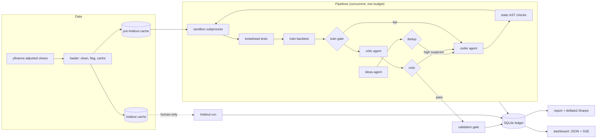

# Alpha Lab

[](https://github.com/RafaelPF07/alpha-lab/actions/workflows/ci.yml)

A research harness for daily equity trading signals. The goal is not to find alpha. The goal is an honest, well-tested pipeline that resists lookahead bias, overfitting and data snooping, plus evidence that it does.

## What it is, and what it deliberately is not

- **Is:** a deterministic backtester, lookahead tests, a sandboxed LLM agent swarm that writes `signal(prices) -> weights` functions, a critic, a validation gate, deflated Sharpe ratios, a one-time holdout, and a local dashboard.
- **Is not:** a trading system. There is no order placement anywhere. Paper trading is a documented stub (`src/alpha_lab/pipeline/paper.py`).

## Architecture



## Setup

Requires Python 3.11+ and [uv](https://docs.astral.sh/uv/).

```bash
uv sync
uv run pytest
```

Put your Anthropic key in `.env` (copy `.env.example`). `.env` is gitignored. Never commit a real key.

## Running each phase

```bash
uv run lab data fetch                       # Phase 0: download and cache prices
uv run lab data summary                     # data-quality report, incl. daily moves beyond +/-15%
uv run lab backtest momentum_12_1 --split train
uv run lab run --pipelines 20 --budget 2.00 # Phases 1-2: the agent swarm, live progress
uv run lab ledger show --run <RUN_ID> --code
uv run lab report --run <RUN_ID>            # Phase 3: Markdown + HTML + figures in runs/<RUN_ID>/
uv run lab holdout --run <RUN_ID> --top 5 --i-understand-this-is-final   # Phase 4: human only
uv run lab dashboard --demo                 # Phase 5: no API calls, synthetic run
uv run lab dashboard --run <RUN_ID>         # Phase 5: a real run
```

## Anti-overfitting design

- **Agents never touch data loading, the backtester or the metrics.** Agents only write `signal(prices)`. A static AST filter, a subprocess sandbox with an import allowlist and a refused network, and a timeout that kills the whole process tree sit around the code.
- **Lookahead tests.** Every signal must pass a truncation test and a perturbation test. `cheater`, a deliberately broken signal that reads tomorrow's return, must fail them. It does.
- **Timing.** Weights decided at the close of day t earn the return from close t to close t+1 (`weights.shift(1) * returns`).
- **Windows.** Train, validation and holdout windows do not overlap. A return counts toward the window of the day it is realised on.
- **Information hiding.** Agents see training-period data only. Validation runs once, after the revision loop has finished, so no agent ever receives a validation result. A test checks that no validation number appears in any request sent to a model.
- **Holdout locking.** Holdout prices live in a separate cache. Only `pipeline/holdout.py` can read it, and a test enforces that. The command needs an explicit flag and an interactive confirmation. Each signal gets exactly one holdout run. The run is recorded before any holdout price is read, so a crash still counts as used. Holdout numbers never appear in the dashboard until that run is complete. This guard is a convention, not a security boundary.
- **Trial counting.** Every attempt that reaches the sandbox is a trial, including failures. Nothing is deleted from the ledger.
- **Deflated Sharpe ratio.** Bailey and Lopez de Prado (2014), with the trial count and the spread of trial Sharpe ratios from the ledger. A Monte Carlo test runs 500 pure-noise series and checks that the best of them is not called significant after deflation.
- **Critic.** A separate model reviews every signal that passes the training gate, looking for hidden lookahead, overfitted constants, market-tracking and fragility. High suspicion sends the signal back to the coder.

## Known limitations

- **Survivorship bias.** The universe is today's large caps and sector ETFs. Companies that failed or left the index are absent, so results are optimistic.
- **Data quality.** yfinance is a free source. Spinoffs, splits and dividend adjustments can be wrong. Daily moves beyond +/-15% are flagged in `lab data summary`. Moves beyond +/-50% are marked extreme.
- **Turnover ignores drift.** Turnover is measured from changes in target weights. A position that drifts and is rebalanced back is not charged for the rebalance. Constant-weight signals show zero turnover and zero cost.
- **No borrowing costs for shorts, no slippage beyond fixed basis points,** and daily close-to-close execution is optimistic.
- **Small universe** of 50 names.
- **Possible LLM lookahead.** Language models may have learned about the post-2010 market during training. This is a subtle form of lookahead, and the harness cannot remove it.
- **Sandbox is not a hardened sandbox.** Windows has no memory or CPU limits. The timeout is the only hard limit, and the in-process guards are layered defences, not a security boundary.
- **The deflated Sharpe formula** was checked against secondary sources and against an independent calculation in the tests, not against the paper's own worked example.
- **The critic is an LLM.** Its judgement is a useful extra check, not a proof.

## Dashboard

`uv run lab dashboard` serves http://localhost:8000.

- **Mission control** (`/`): headline counters, live funnel, pipeline swimlanes, budget gauge, cumulative spend with projected exhaustion, cost by agent, context-size monitor against the 100K pricing tier, event ticker, and the agent swarm graph.
- **Replay** (`/replay?run=<id>`): rebuilds any finished run at 1x, 10x or 100x, with a scrubber.
- **Research** (`/research`): signal galaxy (train against validation Sharpe), luck distribution, equity curves with the holdout shaded and locked, drawdown, correlation map, theme leaderboard, failure anatomy, model economics.
- **Signal inspector** (`/signal?id=<id>`): idea, revision tree, diff between attempts, metrics, critic concerns, LLM calls, holdout status.

Screenshots and a replay GIF go in `docs/` once recorded.

## Results

To be filled in by the author. The first two real runs produced no signal that passed the training gate. Their reports are in `runs/`, which is gitignored.

## Paper trading

Out of scope for now. Connecting a paper-trading broker would mean:

1. A paper-account API key in `.env`, never committed.
2. A daily job that reads the latest weights of an approved signal (from its holdout-tested record, not from the validation metrics).
3. Converting weights to share counts with a fixed capital base and rounding rules.
4. Submitting orders to the paper account only, with a hard check that the endpoint is the paper one.
5. Logging every order and fill to the ledger.

`src/alpha_lab/pipeline/paper.py` is a stub that raises `NotImplementedError`. No order placement exists in this repository.
