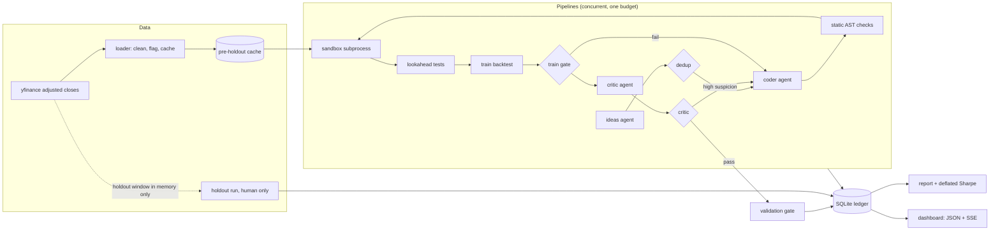

# Alpha Lab

[](https://github.com/RafaelPF07/alpha-lab/actions/workflows/ci.yml)

A research harness for daily equity trading signals. The goal is not to find alpha. The goal is an honest, well-tested pipeline that resists lookahead bias, overfitting and data snooping, plus evidence that it does.

## What it is, and what it deliberately is not

- **Is:** a deterministic backtester, lookahead tests, a sandboxed LLM agent swarm that writes `signal(prices) -> weights` functions, a critic, a validation gate, deflated Sharpe ratios, a one-time holdout, and a local dashboard.
- **Is not:** a trading system. There is no order placement anywhere. Paper trading is a documented stub (`src/alpha_lab/pipeline/paper.py`).
- **Is not a security boundary.** Signal code runs as your Windows user with no network isolation. Read [Sandbox: what it does and does not stop](#sandbox-what-it-does-and-does-not-stop) before you rely on any guard.

## Architecture



## Setup

Requires Python 3.11+ and [uv](https://docs.astral.sh/uv/).

```bash
uv sync
uv run pytest
```

- Only editable installs (`uv sync`) are supported. `config/` and `prompts/` are read from the repository root, and a wheel built from `src/` contains neither.
- Put your Anthropic key in `.env` (copy `.env.example`). `.env` is gitignored. Never commit a real key. Signal code runs as your Windows user and can read `.env` (see the Sandbox section).
- The price cache carries a fingerprint of its tickers, dates and cleaning settings. A cache built before the fingerprint existed is refused, so run `uv run lab data fetch --refresh` once. The fetch stops at `validation_end`.
- The tests are offline by design. `tests/conftest.py` refuses non-loopback `connect`, `connect_ex`, `sendto` and `create_connection` calls, and the model is replaced by scripted fakes (`tests/fakes.py`). The front-end tests use Node's built-in runner, `node --test tests/js/*.test.mjs`. `uv run pytest` also runs them when Node is installed.

## Running each phase

```bash
uv run lab data fetch                       # Phase 0: download and cache prices
uv run lab data summary                     # data-quality report, incl. daily moves beyond +/-15%
uv run lab backtest momentum_12_1 --split train
uv run lab run --pipelines 20 --budget 2.00 # Phases 1-2: the agent swarm, live progress
uv run lab ledger show --run <RUN_ID> --code
uv run lab report --run <RUN_ID>            # Phase 3: Markdown + HTML + figures in runs/<RUN_ID>/
uv run lab holdout --run <RUN_ID> --top 5 --i-understand-this-is-final   # Phase 4: human only
uv run lab dashboard --demo                 # Phase 5: no API calls, synthetic run
uv run lab dashboard --run <RUN_ID>         # Phase 5: a real run
```

- `lab holdout` needs an interactive terminal and a typed confirmation code. It refuses piped or scripted input. `--top` offers the best validated signals by deflated Sharpe ratio. `--attempt` (repeatable) selects specific validated attempts instead.
- A pipeline that hits an unexpected error is recorded with a terminal status, and the run continues. Budget exhaustion, authentication errors and 403 responses end the whole run.
- A run with no event for 30 minutes is marked `abandoned` when the next `lab run` starts, and its running attempts are marked `abandoned` with it.
- A call that ends without a usage report (an error or a cancellation) is charged its full reservation, so spend can be overstated for rejected requests.

## Anti-overfitting design

- **Agents write only `signal(prices)`.** Each piece of generated code first goes through a static AST filter, which rejects a denylist of names, attributes and imports. The filter is a first layer, not a complete check. The code then runs in a sandbox child process with runtime guards. The Sandbox section says what this does and does not stop.
- **Lookahead tests.** Every signal must pass a truncation test and a perturbation test on training-period prices, at five cut-off dates spread between 15% and 95% of the training rows. `cheater`, a deliberately broken signal that reads tomorrow's return, must fail both, and it does (`tests/test_lookahead.py`). A separate test checks that net returns up to a cut-off do not change when later prices change (`tests/test_engine.py`).
- **Timing (same bar).** A weight decided from the close of day t earns the return from close t to close t+1 (`weights.shift(1) * returns`). The decision and the fill share a bar, and no extra delay is modelled. That is optimistic for a signal that could not trade at the close that produced it, and the results are sensitive to this lag (see Known limitations).
- **Windows.** Train, validation and holdout windows do not overlap. A return counts toward the window of the day it is realised on. A backtest window may end up to 7 calendar days after the last price, or start up to 7 days before the first (`WINDOW_TOLERANCE_DAYS` in `backtest/engine.py`). A larger gap raises `BacktestDataError`. In the training and validation stages the attempt then ends as `failed_backtest`.
- **Information hiding.** Agents receive prices only up to `train_end`. Validation runs once, after the revision loop has finished, so the revision loop never sees a validation result, and validation prices are cut at `validation_end`. `tests/test_validation.py::test_validation_metrics_never_reach_any_agent` checks that five renderings of one run's validation metrics do not appear in any request sent to a model: the Sharpe ratio as `repr` and to three decimals, and the annual return, maximum drawdown and average daily turnover as `repr`. A rounded or reformatted number is not caught.
- **Holdout locking.** The holdout is for the owner only.
  - Only `lab holdout` downloads the holdout window. It is held in memory and is never written to disk. The price cache stops at `validation_end`. The SHA-256 of the holdout window is recorded in the ledger with the run.
  - One holdout run per idea (DECISION-3). The rule is keyed on `idea_id`, so a second attempt on the same idea is refused, including a renamed or re-parameterised one. A new idea with near-identical code is still eligible. That gap is open and needs an owner decision.
  - `lab holdout` needs a terminal and a typed code, and it refuses piped or scripted input. A program that controls a pseudo-terminal can still answer the prompt. No in-process check stops that.
  - Claim before read. Every eligible candidate gets a `running` row in one transaction before the holdout window is downloaded. If the run fails or is interrupted, those rows become `error`, and the idea stays used. A `BacktestDataError` during the holdout run also leaves the idea used. Whether a data error should refund the holdout is an open owner decision.
  - Holdout numbers are hidden from the dashboard until that holdout run is complete. Before then the signal endpoint reports `locked`.
  - The holdout is protected by convention and by runtime checks, not by a boundary. Its prices are not on disk, but signal code has no network isolation, so it could in principle download the same public prices itself.
- **Validation numbers are visible to the owner.** Validation metrics appear on research pages and in the signal inspector (DECISION-1). They are never sent to a model.
- **Trial counting.** Every attempt that reaches the sandbox is a trial, including attempts that later fail. The trials table is append-only: a trigger refuses `DELETE` and `UPDATE`. The trial count N uses every trial. The variance V of trial Sharpe ratios uses only attempts that produced a train backtest. The correction is therefore not guaranteed conservative, because attempts that fail early count in N but not in V.
- **Deflated Sharpe ratio.** Bailey and Lopez de Prado (2014), with the trial count N and the spread of the trial Sharpe ratios from the ledger. The trial variance is measured on train-length samples, so it is rescaled to each candidate's validation length before it sets the hurdle: V_adj = V_train x (T_train - 1) / (T_val - 1), where T_train is the median number of train days behind the trials (DECISION-6, `length_matched_variance` in `ledger/report.py`). The SR0 and DSR expressions were checked against secondary sources only. The paper could not be retrieved during the review, so its own expressions are not verified here. The tests check a closed-form DSR value (`tests/test_deflated_sharpe.py`), a 500-series pure-noise Monte Carlo where the best noise series must not be called significant after deflation, and a length-matched noise simulation whose median DSR must lie between 0.35 and 0.65 (`tests/test_report.py`).
- **Critic.** A separate model reviews every signal that passes the training gate, looking for hidden lookahead, overfitted constants, market-tracking and fragility. A `high` suspicion rating sends the signal back to the coder. `low` and `medium` pass.

## Known limitations

- **Survivorship bias.** The universe is today's large caps and sector ETFs. Companies that failed or left the index are absent, so results are optimistic.
- **The universe filter uses pre-holdout data.** Missing data is measured over all pre-holdout rows, which include the validation years, so validation-period data can change which tickers the agents see. The effect is small. No holdout-period data is used.
- **Data quality.** yfinance is a free source. Spinoffs, splits and dividend adjustments can be wrong. Daily moves beyond +/-15% are flagged in `lab data summary`, and moves beyond +/-50% are marked extreme. Prices are adjusted closes, restated backwards from the latest date, so a past adjusted level depends on corporate actions that came later. Ratio features over a window see only actions inside that window. Level-based features can see later actions, and the coder prompt does not yet ban them (owner decision).
- **Turnover and drift.** Turnover is measured from changes in target weights. Between rebalances the engine holds target weights constant. Returns therefore assume a constant mix, not buy-and-hold, and the equal-weight benchmark is constant-mix too. Constant-weight signals pay turnover only at entry, and nothing afterwards.
- **Same-bar execution.** Signals decided at close t earn the return from close t to close t+1, as described above. The results are sensitive to that lag. In a pre-holdout check that is not in the repository, one extra day of lag moved the Sharpe ratio of the `reversal_5d` baseline by about 0.2 to 0.35.
- **No borrowing costs for shorts, and no slippage beyond fixed basis points.** Costs are 5 basis points per side (`config/settings.toml`).
- **Small universe** of 50 names.
- **Possible LLM lookahead.** Language models may have learned about the post-2010 market during training. This is a subtle form of lookahead, and the harness cannot remove it.
- **Sandbox is not a boundary.** The signal runs as your Windows user, can read any file that user can read (including `.env`), and has no network isolation. See the Sandbox section.
- **Lookahead tests cover the signal function only**, on training-period prices. Validation and holdout runs call the same code on later data, and no lookahead test checks that path.
- **The deflated Sharpe ratio.** The expected maximum is a Gumbel approximation, not an exact formula. Against Monte Carlo it is about 0.04 low at N = 2, and within about 0.04 for N from 10 to 500, in standard-deviation units. The variance rescaling assumes that the spread across trials is mostly sampling noise. That is not verified on real trials.
- **The critic is an LLM.** Its judgement is a useful extra check, not a proof.

## Sandbox: what it does and does not stop

What it does:

- Runs a static filter before anything executes. It rejects a denylist of names, attribute names, module names and import forms (`from X import Y`, star imports). It is a first layer, not a complete check.
- Runs the signal in a separate Python process started with `python -I`. The environment keeps only `SYSTEMROOT`, `PATH`, `TEMP` and `TMP`, so no API key is passed to the child. The working directory is a fresh temporary directory that holds only the agent's code. Prices arrive on stdin, and the result comes back as a bounded header and a Parquet body.
- Applies runtime guards in the child: an import allowlist (`numpy`, `pandas`, `math`), builtins such as `vars`, `type`, `eval` and `getattr` withheld from agent code, and checks on file opens and sockets. The socket guard covers `connect`, `connect_ex`, `sendto`, `sendmsg`, `create_connection`, `getaddrinfo` and the `gethostby*` family.
- On Windows, puts the child in a Job Object with kill-on-close, a 1 GiB memory limit per process, a 2 GiB memory limit per job and an active-process limit. The timeout kills the whole job. The child also has a watchdog on its own deadline. If the Job Object cannot be used, `taskkill /T` is the fallback.
- Bounds the output: 32 MiB of stdout, and the last 64 KiB of stderr. Paths in error messages are replaced with `<path>`.
- On POSIX, the child is in its own process group, which is killed in a `finally`, and it sets an 8 GiB address-space limit. This branch has not been run in this environment. The Linux CI job is its first check.

What it does not do:

- It is not an operating-system boundary. The signal runs as your Windows user, with the same file access, so it can read any file that user can read: `.env`, `runs/ledger.db`, the pre-holdout price cache and this repository's source. Moving those files does not change that.
- It has no network isolation. The socket guard is Python code in the child. The C-level modules `_socket` and `_io` are blocked by the static filter only. Code that gets past the filter can reach the network by routes the guards do not cover.
- This machine has no Docker, no WSL and no administrator rights, so there is no container or separate account. A real boundary needs a separate Windows account with no access to the repository and the ledger, or a container with no network. Until then, use a low-limit API key and rotate it after any suspicious run.
- A sandbox failure is recorded as that attempt's status. It does not stop the run.

## Dashboard

`uv run lab dashboard` serves http://localhost:8000. The server listens on 127.0.0.1 only and accepts only the `127.0.0.1` and `localhost` host names, which blocks DNS rebinding from other web pages. It opens the ledger read-only for each request.

- **Mission control** (`/`): headline counters, live funnel, pipeline swimlanes, budget gauge, cumulative spend with projected exhaustion, cost by agent, context-size monitor against the 100K pricing tier, event ticker, and the agent swarm graph.
- **Live pipelines** (`/live`): an animated view of pipelines as they run.
- **Replay** (`/replay?run=<id>`): rebuilds any finished run at 1x, 10x or 100x, with a scrubber.
- **Research** (`/research`): signal galaxy (each signal plotted by train and validation Sharpe ratio), luck distribution, equity curves with the holdout shaded and locked until its run is complete, drawdown, correlation map, theme leaderboard, failure anatomy, model economics.
- **Signal inspector** (`/signal?id=<id>`): idea, revision tree, diff between attempts, metrics, critic concerns, LLM calls, holdout status.

Holdout numbers appear only after that signal's holdout run is complete. Validation numbers are shown to the owner on research pages and in the signal inspector (DECISION-1).

`lab dashboard --demo` writes a synthetic run to `runs/demo.db`, never to the real ledger. The pages show a `DEMO DATA` badge for it. An interrupted demo stays `interrupted`. Delete `runs/demo.db` to regenerate it.

The charts load ECharts 5.5.1 from cdn.jsdelivr.net. The pages allow scripts only from `'self'` and that CDN, and they show a banner when the chart library does not load. The script tags have no subresource-integrity hash yet.

Screenshots and a replay GIF go in `docs/` once recorded.

## Results

The table comes from the ledger (the `runs`, `ideas`, `attempts`, `validations` and `holdout_runs` tables) and from each run's `report.md` where one exists. The logs in `runs/` are not used for any number.

| Run | Kind | Budget / spent | Ideas | Attempts | Passed train gate | Critic passes | Validation passes | Holdout runs | Source |
|---|---|---:|---:|---:|---:|---:|---:|---:|---|
| `f2b583bd9f1a` | research | $2.00 / $0.04 | 20 | 80 | 0 | 0 | 0 | 0 | ledger (no report) |
| `dd10f61a7dc8` | research | $2.00 / $0.09 | 40 | 160 | 0 | 0 | 0 | 0 | report and ledger |
| `637b469e9b82` | **test run** | $0.30 / $0.13 | 40 | 154 | 3 | 3 | 2 | 0 | report and ledger |
| `0bed485bf34a` | failed run | $1.50 / $0.22 | 96 | 368 | 0 | 0 | 0 | 0 | ledger (no report) |

- The two research runs produced no signal that passed the training gate.
- Run `637b469e9b82` is a test run (its log file is `holding_test.log`). Its log prints `critic passes: 2`. Its report and the ledger both give 3: three critic reviews, all rated medium suspicion, and three validation rows, two of them passed. The table uses 3, because the report and the ledger agree.
- Run `0bed485bf34a` ended with status `failed`. Its last three LLM calls (coder, critic and ideas) returned errors within 0.1 seconds of each other, and the ledger records no reason. Nine attempts were left in status `running`. It has no report.
- Nothing has been holdout-tested: `holdout_runs` has no rows.
- Four smaller ledger runs (no more than one idea each, about $0.01 spent in total) are smoke and live-check runs and are not reported here.

Reports are in `runs/`, which is gitignored.

## Paper trading

Out of scope for now. Connecting a paper-trading broker would mean:

1. A paper-account API key in `.env`, never committed.
2. A daily job that reads the latest weights of an approved signal (from its holdout-tested record, not from the validation metrics).
3. Converting weights to share counts with a fixed capital base and rounding rules.
4. Submitting orders to the paper account only, with a hard check that the endpoint is the paper one.
5. Logging every order and fill to the ledger.

`src/alpha_lab/pipeline/paper.py` is a stub that raises `NotImplementedError`. No order placement exists in this repository.
